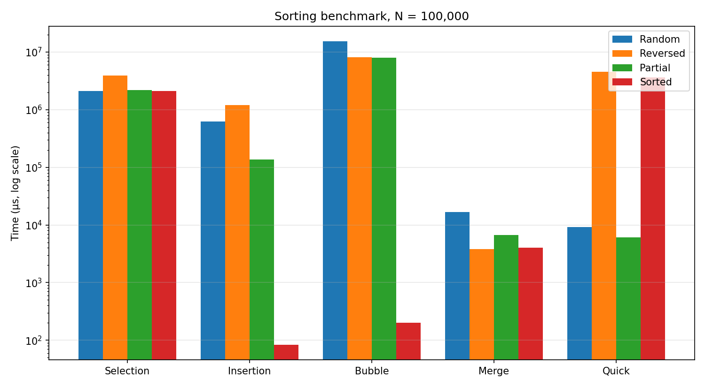

# Benchmark-Algorithms-Sorting

**اسم الطالب:** عبد الرحمن هيثم ميروان  **رقم القيد:** 3169047  **الشعبة:** B

برنامج Java (`SortingBenchmark.java`) يقيس زمن تنفيذ 5 خوارزميات ترتيب على مصفوفة بحجم N = 100,000 في 4 حالات، بالميكروثانية (`System.nanoTime()/1000`). القياس للترتيب فقط، والنسخ يتم قبل بدء المؤقت.

تشغيل: `java SortingBenchmark.java`

## جدول النتائج (µs)
| الخوارزمية | Random | Sorted Reversely | Sorted Partially | Sorted Fully |
|---|---:|---:|---:|---:|
| Selection Sort | 2,121,623 | 3,921,590 | 2,173,816 | 2,108,029 |
| Insertion Sort | 628,231 | 1,208,960 | 136,801 | 84 |
| Bubble Sort (flag) | 15,295,168 | 8,077,285 | 8,019,735 | 202 |
| Merge Sort | 16,679 | 3,848 | 6,728 | 4,000 |
| Quick Sort (pivot = first) | 9,255 | 4,520,409 | 6,076 | 3,606,683 |

الأرقام تتغير قليلًا من تشغيل لآخر حسب الجهاز، والمهم النسب بينها.

## التحليل والمناقشة

**1) O(N²) مقابل O(N log N):** على الإدخال العشوائي كان Merge Sort أسرع من Selection بنحو 127 مرة ومن Bubble بنحو 900 مرة. السبب أن N² = 10¹⁰ عملية تقريبًا بينما N log N ≈ 1.7×10⁶. وكلما كبر N اتسعت الفجوة.

**2) الأفضل مع البيانات المرتبة وشبه المرتبة:** Insertion Sort في الحالة المرتبة تمامًا (84 µs) وBubble المحسّنة (202 µs) يمران مرور واحد فقط O(N). في الحالة شبه المرتبة كان Quick Sort وMerge Sort الأفضل (6,076 و6,728 µs)، بينما Insertion أبطأ (136,801 µs) لأن كل عنصر عشوائي مبعثر يحتاج إزاحة طويلة. Selection لا تستفيد من الترتيب أبدًا لأنها تفحص دائمًا كل الأزواج (≈ N²/2 مقارنة) في كل الحالات. أما Merge Sort فثابت تقريبًا في كل الحالات لأنه O(N log N) دائمًا.
